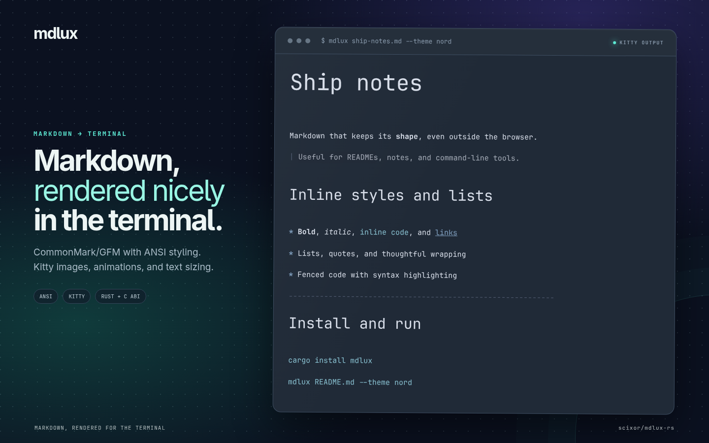
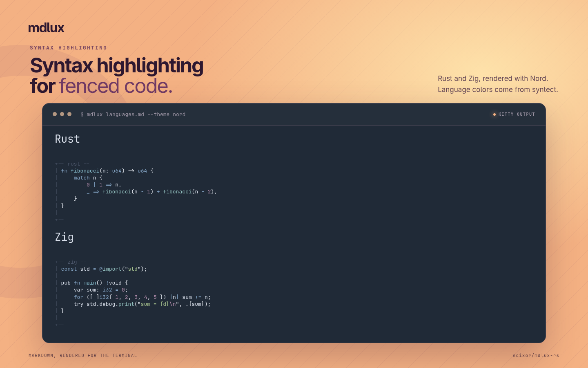
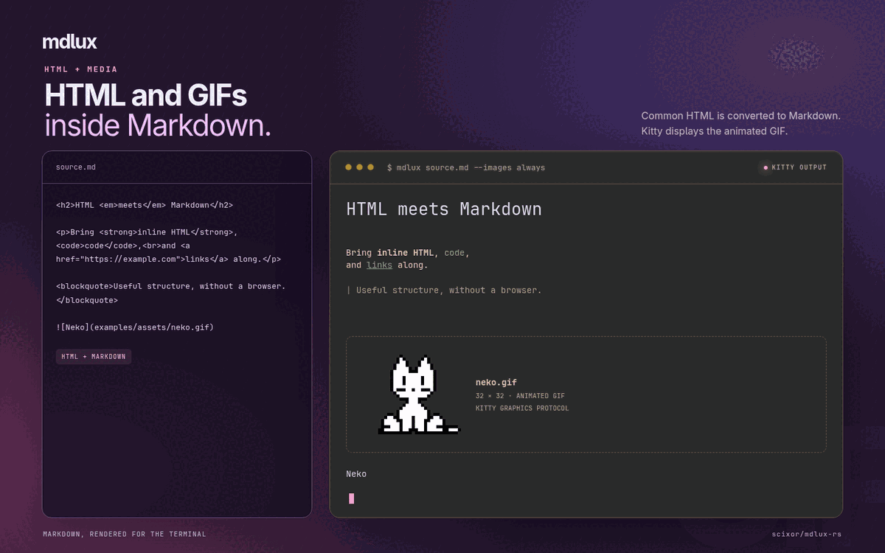
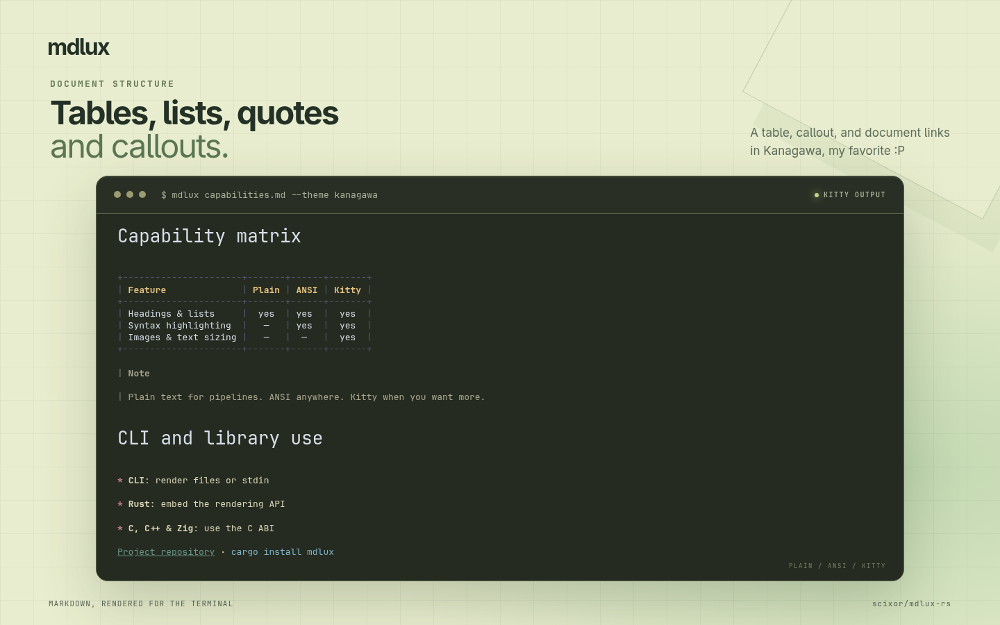

# mdlux

Terminal Markdown renderer which I made for myself because I didn't find others adequate.	ᕕ(⌐■_■)ᕗ ♪♬



Some basic features:
- plain text (just convert it to simple text without styling, quite useful sometimes)
- ANSI styling (for anything other than kitty)
- Kitty enhancements (text sizing and images, including animated GIFs)
- Common inline/block HTML conversion (not full browser HTML/CSS)
- GitHub-style callout labels (`[!NOTE]`, `[!TIP]`, and friends)
- Kitty/table image rendering with media metadata
- Remote HTTP(S) images in the CLI (disable with `--no-remote-images`)
- Usable as a Rust, C, C++, or Zig library for TUIs and terminal tools
- Some themes (built-ins can be cloned and restyled through the library)

## Install

### Cargo (crates.io)

```bash
cargo install mdlux
```

### eget (GitHub releases)

```bash
# usually works directly by picking the matching release asset
eget scixor/mdlux-rs

# if needed, force the asset pattern explicitly
# Linux (x86_64 musl):
eget scixor/mdlux-rs --asset x86_64-unknown-linux-musl
# macOS (Apple Silicon):
eget scixor/mdlux-rs --asset aarch64-apple-darwin
```

## Zig

Use `zig fetch --save=mdlux https://github.com/scixor/mdlux-rs/archive/refs/heads/master.tar.gz` in your project's `build.zig.zon` to install the wrapper.
Then add `mdlux` to your Zig build and link against the package. See `examples/zig` for a smoke app.

## Library use

mdlux is both a CLI and a Markdown-rendering library. The easiest render path is the small UTF-8 API:

```rust
use mdlux::{
    render::{render_markdown, RenderOptions},
    Capabilities,
};

let markdown = "# Hello\n\nSome *text* and `code`.\n";
let options = RenderOptions {
    width: 80,
    ..RenderOptions::default()
};
let output = mdlux::render::render_markdown(markdown, &options)?;
println!("{}", output.text);
```

Themes are values. Start from a built-in theme, clone it, alter any style, and pass it in
`RenderOptions.theme`. `code_theme_name` is optional and chooses the syntax-highlighting palette
separately from document furniture styles.

If you need the same renderer from C, C++, or Zig, use the small C ABI instead. See the
[C API guide](docs/c-api.md).

## Usage

```bash
mdlux README.md
cat README.md | mdlux
# Override width as mdlux tries to fit widh by default
mdlux --theme nord --width 100 doc.md
# Turn off text re-sizing
mdlux --text-size never --images auto README.md
```

## Flags

```text
--width <cols>                                   // if you want to enforce
--theme <ansi|dark|light|nord|gruvbox|kanagawa>  // I like nord/kanagawa a lot
--text-size <auto|always|never>                  // resize text (basically kitty)
--images <auto|always|never>                     // render out images if supportd
--no-remote-images                                  // do not download HTTP(S) images
--no-highlight
--plain
--list-themes
```

## See it in action

### Syntax highlighting

Language-aware colors for fenced code blocks, with themes that keep source readable.



### Inline HTML and animated GIFs

Common inline and block HTML becomes terminal-native Markdown structure. Kitty graphics
supports images and animated GIFs, including frame delays and looping.



### Tables, quotes, and document structure

Markdown structure survives the trip to your terminal. Use plain text for pipelines,
ANSI styling anywhere, and Kitty enhancements where supported.



## Thanks

These Rust libraries do much of the heavy lifting:

- [pulldown-cmark](https://github.com/raphlinus/pulldown-cmark) for CommonMark/GFM parsing
- [html-to-markdown-rs](https://github.com/xberg-io/html-to-markdown) for HTML conversion
- [syntect](https://github.com/trishume/syntect) for syntax highlighting
- [image](https://github.com/image-rs/image) for image and GIF decoding
- [clap](https://github.com/clap-rs/clap) for the command-line interface
- [ureq](https://github.com/algesten/ureq) for remote image downloads
